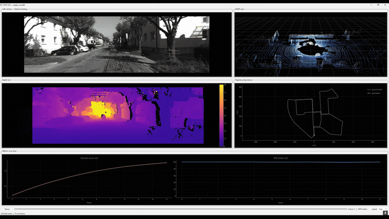

# KITTI Visual Odometry

Stereo + LiDAR visual odometry on the KITTI odometry benchmark, with a real-time
dashboard showing the camera, LiDAR scan, depth map, feature tracking and the
estimated trajectory.

<p align="center">
  
</p>

## Setup

```bash
uv sync                    # add --extra notebook for Jupyter
```

The dataset is not included. Point `--root` at a directory holding `sequences/`
and `poses/` (default `../dataset`).

## Usage

Process a sequence and save the result:

```bash
python -m kitti_vo.runner --seq 00 --end 400
```

Replay it in the dashboard:

```bash
python -m kitti_vo.dashboard --run runs/00
```

Or run the pipeline live, without a precomputed run:

```bash
python -m kitti_vo.dashboard --live --seq 00
```

Replay supports play/pause, seeking and speed control. Live mode streams frames in
order as they are computed, so those controls are disabled.

Live mode runs at about 3.7 fps, because SIFT and SGBM cost roughly 270 ms per
frame between them. Use replay when you want smooth playback.

The defaults are the only configuration tested over a whole sequence. Faster
settings exist, but every one of them costs accuracy, measured over all 4541
frames of sequence 00:

| config | ms/frame | drift |
|---|---|---|
| default (`sift + sgbm + lidar`) | 268 | **0.67%** |
| `--stereo bm` | 217 | 1.00% |
| ORB 3000 feats, `--ratio 0.7` | 133 | 2.03% |
| ORB 3000 feats, `--ratio 0.7 --stereo bm` | 103 | 2.80% |

Short runs do not predict this. Over 400 frames the ORB rows look level with the
default (2.1% against 2.0%); across the full sequence they are three times worse,
because small per-frame errors compound over thousands of pose compositions.
Always compare configurations on a full sequence.

`--detector orb` alone is worse still: ORB finds about 500 keypoints against
SIFT's 2900, so the default `--ratio 0.3` leaves roughly 20 matches per frame,
too few for PnP to solve reliably.

## Pipeline

| Module | Does |
|---|---|
| `calibration.py` | Reads `calib.txt`; focal length and baseline |
| `dataset.py` | Indexed access to images, scans and poses |
| `stereo.py` | Disparity (BM/SGBM) and metric depth |
| `lidar.py` | Projects scans to a sparse depth image; fuses with stereo |
| `features.py` | SIFT/ORB detection and ratio-tested matching |
| `motion.py` | Back-projection and PnP + RANSAC |
| `pipeline.py` | Chains the above into a trajectory |
| `runner.py` | CLI; writes `runs/<seq>/` |

Depth uses `0` as the invalid sentinel throughout.

## Measured on sequence 00

Full sequence, 4541 frames over 3724 m, default settings:

| | final error | drift | time |
|---|---|---|---|
| sift + sgbm + lidar | 24.9 m | 0.67% | 1217 s |

Short runs are not representative. The first ~12 frames carry a scale transient,
so a 250-frame run reports about 1.7% drift against 0.67% for the whole sequence.

Per frame, on 1241x376 images, the default config spends 110 ms in SIFT, 73 ms in
SGBM and 53 ms matching. Those three are most of the cost.

Inlier rate is a poor measure on its own: a starved config can report 98% on 32
points while the default reports 98% on 377. Read it beside the point count.

Stereo depth against LiDAR, where both have a measurement:

| matcher | coverage | median error | within 1 m |
|---|---|---|---|
| `bm` | 44% | 0.24 m | 77% |
| `sgbm` | 86% | 0.20 m | 80% |

## Depth convention

`StereoDepth.depth` returns a value for every pixel. Disparities OpenCV could not
match are floored at 0.1, which puts them near 3861 m — far outside any real
scene. `estimate_motion` drops them with its `max_depth` cut, and the dashboard
excludes them when scaling its colour range.
